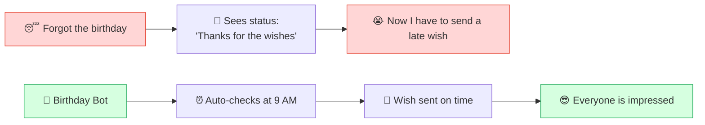
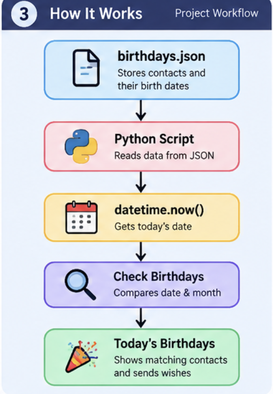
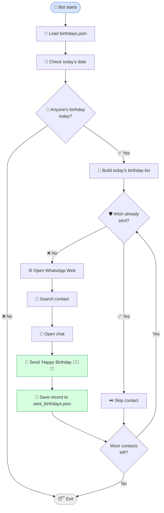
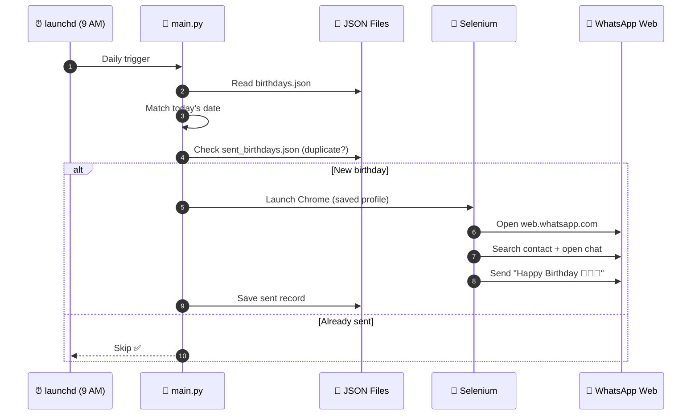
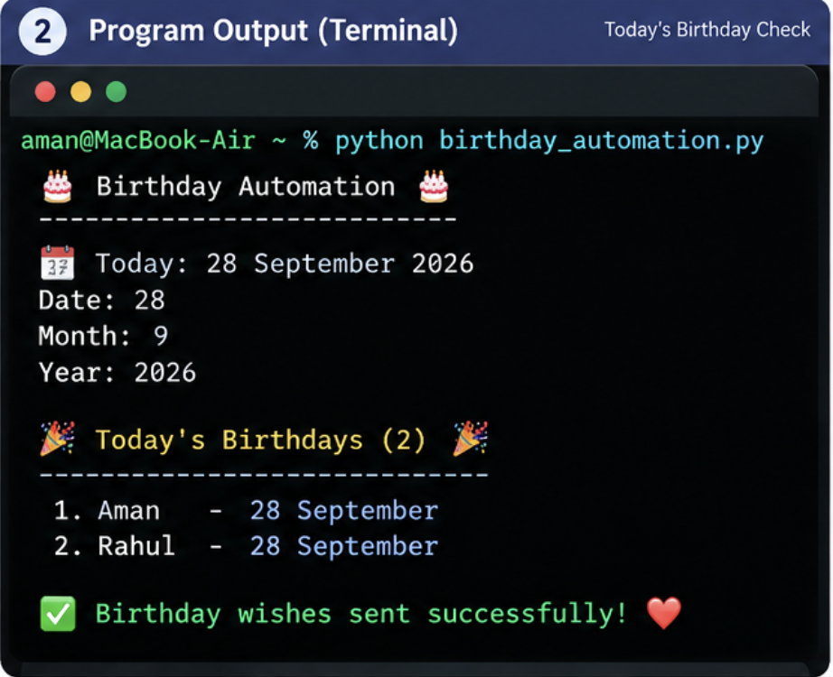
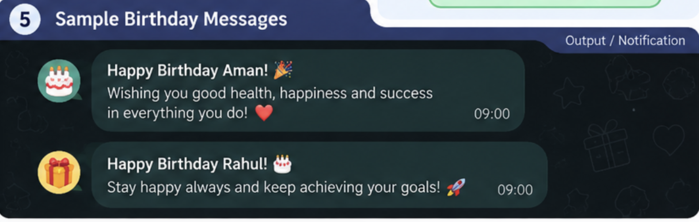
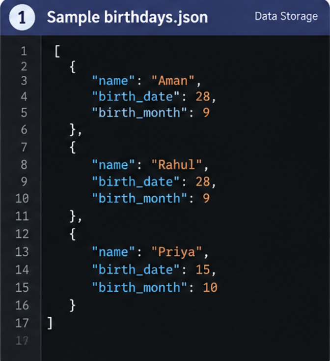
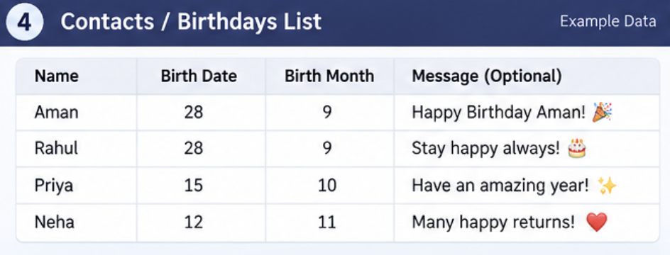
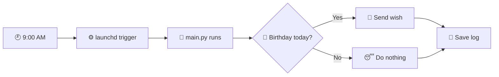
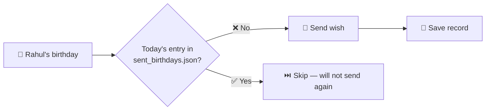

<div align="center">


# 🎂 WhatsApp Birthday Bot

### *"Bro, when was your birthday again?" 😭* — never have to say that again.


**A small project that solves one very real problem.**

[The Problem](#-the-problem) •
[Features](#-features) •
[How It Works](#%EF%B8%8F-how-it-works) •
[Quick Start](#-quick-start) •
[Add a Birthday](#-adding-a-birthday) •
[Automation](#-automatic-run-9-am-daily) •
[FAQ](#-troubleshooting--faq)

</div>

---

## 😭 The Problem

As a student and as a human, I almost always forget people's birthdays 😂

And somehow I only remember after seeing that person's WhatsApp status:

> *"Thank you everyone for the wishes 🥲"*



**The solution:** save contacts' birthdays in a JSON file. The program checks the date every day and automatically sends a birthday wish from my device through WhatsApp Web.

> 💡 This is also a practical project for a B.Tech CSE student — it combines **Python, JSON, Selenium, automation, file handling, and scheduling** in one real-world project.

---

## 🚀 Features

| | Feature | Details |
|---|---|---|
| 📅 | **JSON Storage** | All birthdays live in `birthdays.json` |
| 🔎 | **Automatic Date Check** | Finds whose birthday is today on its own |
| 💬 | **Contact Search** | Searches the contact on WhatsApp Web and opens the chat |
| 🎉 | **Auto Wish** | Sends `Happy Birthday 🎉🥳🎂` |
| 👥 | **Multiple Birthdays** | Handles several birthdays on the same day |
| 🛡️ | **Duplicate Protection** | Never sends two wishes on the same day |
| 💾 | **Sent Records** | Keeps a log in `sent_birthdays.json` |
| 🌐 | **Saved Session** | Uses a Chrome profile, so no repeated QR scans |
| ⏰ | **Daily Scheduler** | Runs every day at 9:00 AM via macOS `launchd` |
| 🧩 | **Zero Code Changes** | Add new birthdays without touching `main.py` |

---

## 🛠️ Tech Stack

| Tool | Purpose |
|---|---|
| 🐍 **Python** | Core logic |
| 🤖 **Selenium** | Browser automation |
| 📄 **JSON** | Birthday data and sent records |
| 💬 **WhatsApp Web** | Delivery channel |
| 🌐 **Google Chrome** | Browser (with a saved profile) |
| 🍎 **macOS launchd** | Daily scheduling |

---

## ⚙️ How It Works

### 🧭 Project Workflow at a Glance

<div align="center">
  
</div>

### 🔄 Main Flow



### 🧠 Behind the Scenes (Sequence)



---

## 📁 Project Structure

```text
Whatsapp_birthday_bot/
│
├── 🐍 main.py                  # Core bot logic
├── 📄 birthdays.json           # Birthday database (edit this one)
├── 📦 requirements.txt         # Dependencies
├── 🙈 .gitignore               # Excludes personal files
├── 🖼️ assets/                  # README images (banner, screenshots)
├── 📘 README.md                # You are here
│
│   ── 🔒 Runtime files (not committed to git) ──
├── 🌐 chrome_profile/          # Saved WhatsApp session
├── 💾 sent_birthdays.json      # Duplicate-protection record
├── 📝 birthdaybot.log          # Normal logs
└── ⚠️ birthdaybot_error.log    # Error logs
```

---

## ⚡ Quick Start

### 1️⃣ Clone & Install

```bash
git clone <your-repo-url>
cd Whatsapp_birthday_bot
pip install -r requirements.txt
```

### 2️⃣ Add Birthdays
Add your contacts to `birthdays.json` ([see below](#-adding-a-birthday)).

### 3️⃣ First Run (scan the QR — only once)

```bash
python main.py
```

Chrome opens → **scan the WhatsApp Web QR code**. The session is saved in `chrome_profile/`, so you won't need to scan again. ✅

### 4️⃣ Manual Run (for testing)

```bash
cd ~/Desktop/Whatsapp_birthday_bot
/opt/anaconda3/bin/python main.py
```

#### 🖥️ Example terminal output

<div align="center">
  
</div>

#### 💬 Example messages sent

<div align="center">
  
</div>

> 📸 Screenshots are illustrative examples of the output. Your script name and message text may differ.

---

## 📝 Adding a Birthday

Open `birthdays.json` and add a new entry:

```json
{
    "name": "Rahul",
    "birth_month": 10,
    "birth_date": 5
}
```

Full file example:

```json
[
    {
        "name": "Rahul",
        "birth_month": 10,
        "birth_date": 5
    },
    {
        "name": "Priya",
        "birth_month": 12,
        "birth_date": 25
    }
]
```

#### 📄 Sample `birthdays.json`

<div align="center">
  
</div>

#### 👥 Example contacts list

<div align="center">
  
</div>

> ✅ **That's it.** No change is required in `main.py`.
> ⚠️ Write `name` exactly as the contact is **saved in WhatsApp**, otherwise the search will fail.

---

## ⏰ Automatic Run (9 AM Daily)

On macOS, the project is configured to run automatically **every day at 9:00 AM**, so you never need to run `main.py` by hand.



<details>
<summary>📂 <b>Sample launchd .plist (click to expand)</b></summary>

<br>

Path: `~/Library/LaunchAgents/com.birthdaybot.plist`
*(adjust paths for your own system)*

```xml
<?xml version="1.0" encoding="UTF-8"?>
<!DOCTYPE plist PUBLIC "-//Apple//DTD PLIST 1.0//EN"
  "http://www.apple.com/DTDs/PropertyList-1.0.dtd">
<plist version="1.0">
<dict>
    <key>Label</key>
    <string>com.birthdaybot</string>

    <key>ProgramArguments</key>
    <array>
        <string>/opt/anaconda3/bin/python</string>
        <string>/Users/YOUR_USERNAME/Desktop/Whatsapp_birthday_bot/main.py</string>
    </array>

    <key>WorkingDirectory</key>
    <string>/Users/YOUR_USERNAME/Desktop/Whatsapp_birthday_bot</string>

    <key>StartCalendarInterval</key>
    <dict>
        <key>Hour</key>
        <integer>9</integer>
        <key>Minute</key>
        <integer>0</integer>
    </dict>

    <key>StandardOutPath</key>
    <string>/Users/YOUR_USERNAME/Desktop/Whatsapp_birthday_bot/birthdaybot.log</string>
    <key>StandardErrorPath</key>
    <string>/Users/YOUR_USERNAME/Desktop/Whatsapp_birthday_bot/birthdaybot_error.log</string>
</dict>
</plist>
```

To load / unload:

```bash
launchctl load ~/Library/LaunchAgents/com.birthdaybot.plist
launchctl unload ~/Library/LaunchAgents/com.birthdaybot.plist
```

</details>

---

## 🛡️ Duplicate Protection

The bot stores successfully sent birthdays in:

```text
sent_birthdays.json
```



If the same birthday is processed again on the same day, the bot **skips** that contact instead of sending another message. No spam. 😌

---

## 🔐 Personal Use & Privacy

- 🎯 This project is mainly built for **personal use and learning** as a B.Tech CSE student.
- 🔒 The WhatsApp session is kept inside the local `chrome_profile/` folder.
- 🙈 Personal runtime files (`chrome_profile/`, logs, sent records) are excluded using `.gitignore`.

> ⚠️ **Never push `chrome_profile/` to GitHub** — it contains your WhatsApp login session.

<details>
<summary>📄 <b>Recommended .gitignore</b></summary>

```gitignore
chrome_profile/
sent_birthdays.json
birthdaybot.log
birthdaybot_error.log
__pycache__/
*.pyc
```

</details>

---

## 🧯 Troubleshooting / FAQ

<details>
<summary>❓ <b>The bot didn't send a wish — what should I check?</b></summary>

<br>

1. Open `birthdaybot_error.log` — the error will be there
2. Make sure the month/date in `birthdays.json` is correct
3. Make sure the contact `name` matches the name saved in WhatsApp
4. Is WhatsApp Web still logged in? (If `chrome_profile/` was deleted, scan the QR again)
5. Was your Mac on and awake at 9 AM?

</details>

<details>
<summary>❓ <b>I have to scan the QR code every time</b></summary>

<br>

Check that `chrome_profile/` is being saved at the correct path. If the folder is deleted or corrupted, the session is lost.

</details>

<details>
<summary>❓ <b>Selenium can't find an element (selectors failing)</b></summary>

<br>

WhatsApp Web's UI changes over time. When that happens, the **Selenium selectors in `main.py` need to be updated** (use Inspect Element in the browser to find the new selector).

</details>

<details>
<summary>❓ <b>What if two people have a birthday on the same day?</b></summary>

<br>

The bot wishes both of them, one after another. ✅

</details>

<details>
<summary>❓ <b>How do I change the message?</b></summary>

<br>

Edit the wish string in `main.py` (default: `Happy Birthday 🎉🥳🎂`).

</details>

---

## 🗺️ Future Ideas

- [ ] 🎨 A list of random wishes (a different message each time)
- [ ] 🏷️ Personalized messages (`Happy Birthday Rahul 🎂`)
- [ ] 🔔 Mac notification when the bot runs
- [ ] 🔮 Reminder to myself about tomorrow's birthdays
- [ ] 🪟 Windows Task Scheduler / 🐧 Linux cron support
- [ ] 🖥️ A small GUI to add birthdays

---

## 📌 Note

WhatsApp Web's interface can change over time, so Selenium selectors may need updates if WhatsApp changes its webpage structure.

---

<div align="center">

**Made with Python ❤️🐍**

*A small project to solve one very real problem:*
**"Bro, when was your birthday again?" 😭**

⭐ If you liked it, give the repo a star!

</div>